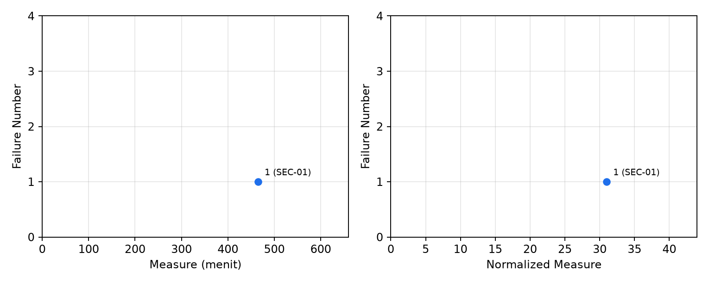
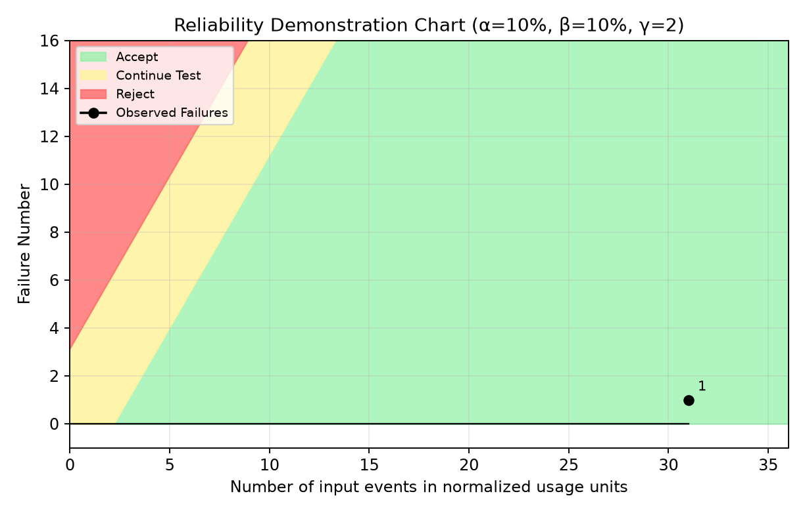

# Pengujian Kobi (worksheet Modul 11)

Dokumen ini merangkum pengujian untuk tugas Software Testing: profil operasional, alokasi test case, 26 test case, data kegagalan dengan Reliability Demonstration Chart (RDC), dan uji kualitas ISO/IEC 25010. Versi lengkap berbentuk worksheet (.docx) disimpan di luar repo; semua angka di sini berasal dari eksekusi nyata (`docs/pengujian/hasil-eksekusi-*.json`).

## Cara menjalankan

```bash
CONTAINER_CLI=podman bash scripts/test-integration.sh tests/integration/worksheet-tc.test.ts tests/integration/iso25010.test.ts
```

Postgres 16 dinyalakan sementara oleh skrip. Azure OpenAI ditiru dengan `fetch` tiruan, tanpa jaringan.

## 1. Profil operasional

Mode: Normal. Initiator: User. *Occurrence rate* adalah asumsi frekuensi relatif per 100 operasi pengguna (belum ada log produksi); probabilitas = rate / 100.

| Operasi | Rate | Probabilitas | Jumlah test case |
|---|---|---|---|
| Catat makan (teks bebas + estimasi AI) | 22 | 0.22000 | 6 |
| Lihat gizi harian dan kesenjangan | 16 | 0.16000 | 4 |
| Login | 14 | 0.14000 | 3 |
| Check-in energi dan fokus | 12 | 0.12000 | 3 |
| Register | 8 | 0.08000 | 2 |
| Lihat riwayat makan | 8 | 0.08000 | 2 |
| Minta rekomendasi warung | 7 | 0.07000 | 2 |
| Lihat tren mingguan | 5 | 0.05000 | 1 |
| Atur profil dan target gizi | 4 | 0.04000 | 1 |
| Kelola jadwal kuliah | 3 | 0.03000 | 1 |
| Reproses estimasi AI yang tertunda | 1 | 0.01000 | 1 |
| **Total** | 100 | 1 | 26 |

Total test case = 130 menit x 3 penguji / 15 menit = 26. Threshold = 0,5 / 26 = 0.0192; operasi di bawahnya mendapat 1 test case, sisanya dibagi menurut probabilitas (sisa terbesar).

## 2. Test case (tests/integration/worksheet-tc.test.ts)

| ID | Operasi | Kondisi | Aksi | Input | Hasil diharapkan | Eksekusi 1 |
|---|---|---|---|---|---|---|
| TC-01 | Register | Positif | Mendaftarkan akun baru | Email unik, password 17 karakter, nama "Mahasiswa Uji" | 201; password tersimpan sebagai hash argon2id, bukan teks asli | Pass |
| TC-02 | Register | Negatif | Mendaftar dengan email yang sudah terdaftar | Email yang sama dengan akun TC-01, nama berbeda | 409 EMAIL_TAKEN; tidak ada akun ganda | Pass |
| TC-03 | Login | Positif | Login dengan kredensial benar | Email dan password akun terdaftar | Pengguna dikembalikan (id, email, nama) | Pass |
| TC-04 | Login | Negatif | Login dengan password salah | Email terdaftar, password salah | Ditolak (tidak ada pengguna dikembalikan) | Pass |
| TC-05 | Login | Negatif | Login dengan email belum terdaftar | Email yang tidak ada di basis data | Ditolak | Pass |
| TC-06 | Catat makan | Positif | Mencatat makan, AI berhasil | teks_input "nasi telur dadar", waktu 21 Nov 2026 12:00 WIB | 201; catatan dan estimasi gizi tersimpan (protein 20 g, 520 kkal) | Pass |
| TC-07 | Catat makan | Negatif | Mencatat dengan teks kosong | teks_input "   " | 400 VALIDATION_ERROR; tidak ada catatan; AI tidak dipanggil | Pass |
| TC-08 | Catat makan | Negatif | Mencatat tanpa login | Tanpa sesi, teks_input "nasi goreng" | 401 UNAUTHORIZED; tidak ada catatan | Pass |
| TC-09 | Catat makan | Positif | Mencatat saat layanan AI gagal (HTTP 500) | teks_input "nasi goreng"; Azure OpenAI membalas 500 | 201 dengan estimasi_tertunda=true; catatan tetap tersimpan, tanpa estimasi | Pass |
| TC-10 | Catat makan | Negatif | Mencatat dengan teks 501 karakter | teks_input berisi 501 huruf (batas 500) | 400; AI tidak dipanggil; tidak ada catatan | Pass |
| TC-11 | Catat makan | Negatif | Mencatat dengan total harga negatif | total_harga -5000 | 400 VALIDATION_ERROR; tidak ada catatan | Pass |
| TC-12 | Gizi harian | Positif | Melihat gizi hari berisi dua catatan | Dua catatan (20 g protein, 520 kkal masing-masing); target protein 60 g | asupan protein 40 g, kalori 1040; kesenjangan protein: kurang 20 g | Pass |
| TC-13 | Gizi harian | Positif | Melihat gizi hari tanpa catatan | tanggal 2026-11-20 tanpa catatan | asupan semua nol; empat zat tampil sebagai kekurangan penuh | Pass |
| TC-14 | Gizi harian | Negatif | Meminta tanggal yang tidak ada di kalender | tanggal=2026-02-31 | 400 VALIDATION_ERROR | Pass |
| TC-15 | Gizi harian | Positif | Menguji batas hari WIB | Makan 21 Nov 23:30 WIB dan 22 Nov 00:30 WIB | Masing-masing masuk ke harinya (satu catatan per hari) | Pass |
| TC-16 | Check-in | Positif | Check-in untuk catatan milik sendiri | meal_log_id milik sendiri, energi 4, fokus 3 | 201; tersimpan atas user_id dari sesi | Pass |
| TC-17 | Check-in | Negatif | Check-in dengan energi di luar skala | tingkat_energi 6 (skala 1-5) | 400; tidak tersimpan | Pass |
| TC-18 | Check-in | Negatif | Check-in pada catatan milik pengguna lain | meal_log_id milik pengguna lain | 404; tidak tersimpan | Pass |
| TC-19 | Riwayat makan | Positif | Melihat riwayat satu hari | Tiga catatan: pagi, malam (21 Nov) dan satu hari sebelumnya | Hanya dua catatan 21 Nov, terbaru dulu | Pass |
| TC-20 | Riwayat makan | Negatif | Mencoba melihat catatan pengguna lain | Catatan milik pengguna lain pada tanggal yang sama | Jumlah 0; teks catatan orang lain tidak muncul | Pass |
| TC-21 | Rekomendasi | Positif | Meminta rekomendasi dengan anggaran Rp20.000 | Dua menu: Rp15.000 dan Rp50.000, warung buka dan dekat | Hanya menu Rp15.000 yang direkomendasikan | Pass |
| TC-22 | Rekomendasi | Negatif | Meminta rekomendasi dengan latitude tidak valid | latitude 200 (rentang -90..90) | 400 VALIDATION_ERROR | Pass |
| TC-23 | Tren mingguan | Positif | Melihat tren dengan tiga check-in | Tiga check-in minggu 16-22 Nov: energi 5,3,4; fokus 2,3,4 | status ok; rata-rata energi 4, fokus 3; disclaimer non-medis ada | Pass |
| TC-24 | Atur profil | Positif | Mengisi data fisik | Lahir 2003-05-10, perempuan, 55,5 kg, 160 cm | 200; target gizi dihitung dan tersimpan (sekitar 1759 kkal, zat besi 18 mg) | Pass |
| TC-25 | Kelola jadwal | Negatif | Menambah jadwal dengan jam terbalik | jam_mulai 10:00, jam_selesai 08:00 | 400; jadwal tidak tersimpan | Pass |
| TC-26 | Reproses estimasi | Positif | Reproses setelah AI pulih | Catatan tertunda; Azure OpenAI diubah dari gagal ke berhasil | Estimasi tersimpan tepat satu baris; catatan tidak ganda | Pass |

Uji mutasi: verifikasi password dimatikan membuat TC-04 gagal; offset WIB dihapus membuat TC-15 gagal. Artinya tes memang bisa mendeteksi kerusakan.

## 3. Data kegagalan dan RDC

Eksekusi 1: 42 tes (26 TC + 16 uji ISO), 41 lolos, 1 gagal (SEC-01). Measure = urutan eksekusi x 15 menit, karena tes otomatis hanya makan sekitar 11 detik. FIO = 1 failure / 15 menit.

| Failure | Kumulatif | Tes | Measure (menit) | Normalized |
|---|---|---|---|---|
| 1 | 1 | SEC-01 (urutan 31) | 465 | 31 |

RDC: α=10%, β=10%, γ=2. A=-2.1972, B=2.1972, ln γ=0.6931. Batas accept Tn = 2.1972 + 0.6931 n; batas reject Tn = -2.1972 + 0.6931 n (memotong sumbu n di 3.17). Titik (31, 1) jauh di kanan batas accept pada n=1 (x=2.89): **Accept**.





Keterbatasan: tes deterministik yang ditulis dari spesifikasi, bukan sampel acak dari pemakaian nyata; hasilnya menunjukkan kesiapan terhadap profil yang diasumsikan, bukan jaminan keandalan produksi.

## 4. Kualitas ISO/IEC 25010 (tests/integration/iso25010.test.ts)

Model Software Product Quality; karakteristik: Functional Suitability, Security, Reliability.

| ID | Karakteristik: sub | Uji | Ukuran | Eksekusi 1 | Eksekusi 2 |
|---|---|---|---|---|---|
| FS-01 | Functional Suitability: Functional Completeness | Setiap operasi profil operasional punya handler | 13 dari 13 handler | Pass | Pass |
| FS-02 | Functional Suitability: Functional Correctness | Target gizi = hitungan manual Mifflin-St Jeor | 5 nilai cocok persis | Pass | Pass |
| FS-03 | Functional Suitability: Functional Correctness | Kesenjangan = target - asupan, tidak negatif, terurut | 4 zat, urutan benar | Pass | Pass |
| FS-04 | Functional Suitability: Functional Appropriateness | Tren memuat disclaimer, narasi tanpa klaim diagnosis | disclaimer ada, 0 klaim | Pass | Pass |
| SEC-01 | Security: Authenticity | Semua endpoint terlindungi menjawab 401 tanpa sesi | 12 endpoint | FAIL | Pass |
| SEC-02 | Security: Integrity / authorization | Pengguna B tidak bisa baca atau ubah data pengguna A | 3 percobaan, 0 berhasil | Pass | Pass |
| SEC-03 | Security: Confidentiality | Password tidak ada di respons maupun tersimpan mentah | 0 kebocoran | Pass | Pass |
| SEC-04 | Security: Integrity | SQL injection disimpan sebagai data; user_id palsu diabaikan | tabel utuh, pemilik benar | Pass | Pass |
| SEC-05 | Security: Resistance to abuse | Melebihi batas catat makan dijawab 429 + Retry-After | 31 permintaan, ke-31 ditolak | Pass | Pass |
| SEC-06 | Security: Confidentiality | Galat internal tidak membocorkan SQL atau stack | 0 detail bocor | Pass | Pass |
| REL-01 | Reliability: Fault Tolerance | AI gagal (HTTP 500 dan timeout): catatan tetap tersimpan | 2 mode gagal, 0 data hilang | Pass | Pass |
| REL-02 | Reliability: Fault Tolerance | DB tidak terjangkau dijawab 503 DB_UNAVAILABLE | 2 endpoint baca | Pass | Pass |
| REL-03 | Reliability: Recoverability | Reproses setelah AI pulih; reproses ganda tidak menggandakan | 1 estimasi dari 2 reproses | Pass | Pass |
| REL-04 | Reliability: Fault Tolerance | Body rusak atau salah tipe dijawab 400, bukan 500 | 6 endpoint x 6 body = 36 kasus | Pass | Pass |
| REL-05 | Reliability: Maturity | 5 catat makan bersamaan, semuanya tersimpan | 5 dari 5 | Pass | Pass |
| REL-06 | Reliability: Maturity | Register bersamaan email sama menghasilkan 1 akun | 4 permintaan, 1 akun | Pass | Pass |

### DEF-01 (ditemukan SEC-01, sudah diperbaiki)

`POST /api/recommendations` tanpa sesi tidak dijawab 401: handler memvalidasi body lalu melayani tamu. Spesifikasi (`docs/architecture.md` bagian 6) mewajibkan login. Di produksi `proxy.ts` masih menahan permintaan tanpa login, jadi pengguna tidak terdampak; risikonya endpoint yang memanggil Azure Maps terbuka bila matcher middleware berubah. Perbaikan: handler memanggil `requireUser` lebih dulu. Eksekusi 2 (120 tes integrasi): 120 lolos.

### Temuan lanjutan (belum diperbaiki)
- `POST /api/recommendations` belum punya rate limit (memanggil Azure Maps).
- `DELETE /api/schedules/{id}` milik orang lain menjawab 403, bukan 404, sehingga membocorkan bahwa id itu ada.
